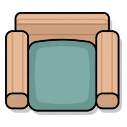
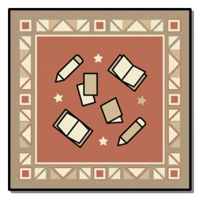
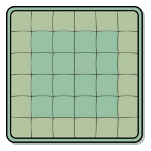
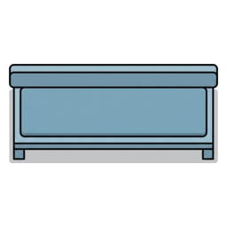
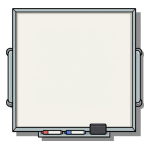
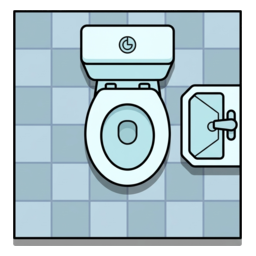

# ILSdoku — Cas de mostra: «El forat de l'horari»

> Cas complet i **validat per ordinador**: la solució (incloent qui es queda sense
> plaça) és **única** i es pot resoldre **sense endevinar**.
>
> És la **versió enriquida**: en comptes de fer servir només relacions de distància
> (més avall, més amunt, tantes columnes a l'esquerra…), les pistes parlen d'**objectes**
> del centre («era sobre una estoreta», «seia en un banc», «era al costat de la
> pissarra»), d'**unicitat** («era l'única ILS de la seva sala»), de **lloc** («era a
> l'INS Escola del Treball») i de **negacions** («no seia mai en cap cadira»), que són
> les que permeten demostrar **qui es queda sense plaça** sense regalar-ho.

## Fitxa

| | |
|---|---|
| **Títol** | El forat de l'horari |
| **Dificultat** | Fàcil |
| **Graella** | 7×7 (una ILS per fila i per columna) |
| **Places** | 7 |
| **Candidates** | 8 ILS — **Laura M es queda sense plaça** |
| **Torns** | Matí (files R1–R4): 5 candidates per a 4 places · Tarda (files R5–R7): 3 candidates per a 3 places |
| **Centres** | 4 |
| **Pistes** | 8 (una per cada ILS: 7 col·locades + la que queda fora) |

## El tauler

Cada centre és una zona del tauler; el nombre entre parèntesis és la seva **demanda**
(les ILS que hi han de treballar). A cada casella hi ha, si hi és, un **objecte**.

**Zona MATÍ** (files R1–R4)

| | C1 | C2 | C3 | C4 | C5 | C6 | C7 |
|---|---|---|---|---|---|---|---|
| **R1** | Cadira | Catifa | Ordinador | · | · | Taula | Cadira |
| **R2** | Pissarra | · | · | Estoreta | Prestatge | · | · |
| **R3** | Banc | · | · | Lavabo | · | · | Prestatge |
| **R4** | · | Cadira | · | Ordinador | · | Cadira | Màquina de cafè |

**Zona TARDA** (files R5–R7)

| | C1 | C2 | C3 | C4 | C5 | C6 | C7 |
|---|---|---|---|---|---|---|---|
| **R5** | Pissarra | · | · | Lavabo | · | Taula | · |
| **R6** | · | Cadira | · | · | Catifa | Prestatge | Rellotge |
| **R7** | Cadira | · | Taula | · | Pissarra | · | Catifa |

**Centres i demandes**

| Centre | Torn | Caselles | Demanda |
|---|---|---|---|
| FEP Aprenents EE | Matí | R1–R4 × C1–C4 | **3** |
| Institut dels Aliments | Matí | R1–R4 × C5–C7 | **1** |
| INS Escola del Treball | Tarda | R5–R7 × C1–C5 | **2** |
| Institut de Logística de Barcelona | Tarda | R5–R7 × C6–C7 | **1** |

**Glossari d'objectes** (el mateix que surt al botó **📖 Glossari** de l'app)

| Imatge | Objecte | Ocupable? | Descripció |
|---|---|---|---|
|  | Cadira | **Sí** | Seient de classe |
|  | Catifa | **Sí** | Catifa de terra de l'aula |
|  | Estoreta | **Sí** | Estoreta per seure a terra (n'hi ha una de sola) |
|  | Banc | **Sí** | Banc del passadís (n'hi ha un de sol) |
|  | Ordinador | No | Ordinador de l'aula |
|  | Pissarra | No | Pissarra de classe |
|  | Taula | No | Taula de treball o de menjador |
|  | Prestatge | No | Prestatge de llibres |
|  | Lavabo | No | Lavabo del centre |
|  | Màquina de cafè | No | Màquina de cafè de la sala de professors |
|  | Rellotge | No | Rellotge de paret (n'hi ha un de sol) |

> Els objectes **ocupables** deixen seure-hi una ILS; els **no ocupables** bloquegen la
> casella. Hi ha objectes **únics** al tauler (estoreta, banc i rellotge): això fa que una
> pista com «era sobre una estoreta» o «seia en un banc» assenyali directament una casella.
>
> 🖼️ Les il·lustracions originals són a `Imatges/` i es preparen per a l'app amb
> `tools/make_images.sh` (retall del fons + mida 256×256) cap a `app/img/`.

## Les candidates i les seves pistes

| ILS | Torn | Pista |
|---|---|---|
| Oscar | Matí | era sobre una catifa |
| José Javier | Matí | era sobre una estoreta |
| Carla | Matí | seia en un banc |
| Judit | Matí | no era mai sobre cap catifa |
| Aroha | Tarda | era a l'INS Escola del Treball |
| Miriam | Tarda | era al costat de la pissarra |
| Irene | Tarda | era l'única ILS de la seva sala |
| **Laura M** | Matí | no seia mai en cap cadira |

> **Ningú no té la targeta buida.** La Laura M es queda fora, però la seva pista (una
> negació) és certa: si no és enlloc, no pot seure enlloc; i és, precisament, la pista que
> **demostra** que no pot ocupar l'última plaça lliure. La Judit també té una pista
> només negativa i, en canvi, **sí** que té plaça: així la forma de la targeta no delata
> res (vegeu §5.1 del document de disseny).

> Regla del joc: una ILS per fila i per columna; cada centre ha de tenir exactament la
> seva demanda; i només es pot seure a les caselles **ocupables** (no a sobre d'una
> taula, una pissarra, un ordinador, un prestatge, un lavabo, una màquina de cafè o un
> rellotge).

**Tipus de pista emprats**

| Tipus | Exemple |
|---|---|
| Sobre un objecte (*on*) | «era sobre una catifa», «seia en un banc» |
| Únic a la sala (*alone*) | «era l'única ILS de la seva sala» |
| Al costat d'un objecte (*beside*) | «era al costat de la pissarra» |
| Lloc (centre) | «era a l'INS Escola del Treball» |
| Negació sobre un objecte (*onNone*) | «no era mai sobre cap catifa», «no seia mai en cap cadira» |

> **Cap pista de distància**: tot es dedueix per objectes, unicitat, «al costat», lloc i
> negacions.

## Solució

```
        C1   C2   C3   C4   C5   C6   C7
R1 (M)  .    O    .    .    .    .    .
R2 (M)  .    .    .    JJ   .    .    .
R3 (M)  C    .    .    .    .    .    .
R4 (M)  .    .    .    .    .    J    .
R5 (T)  .    .    A    .    .    .    .
R6 (T)  .    .    .    .    M    .    .
R7 (T)  .    .    .    .    .    .    I
```

- **Oscar** → R1 C2 (FEP Aprenents EE) — *sobre una catifa*
- **José Javier** → R2 C4 (FEP Aprenents EE) — *sobre una estoreta*
- **Carla** → R3 C1 (FEP Aprenents EE) — *seia en un banc*
- **Judit** → R4 C6 (Institut dels Aliments) — *no era mai sobre cap catifa*
- **Aroha** → R5 C3 (INS Escola del Treball) — *era a l'INS Escola del Treball*
- **Miriam** → R6 C5 (INS Escola del Treball) — *al costat de la pissarra*
- **Irene** → R7 C7 (Institut de Logística de Barcelona) — *única ILS de la seva sala*
- **Laura M** → **SENSE PLAÇA** ← la incògnita que cal descobrir

**Com es demostra que la Laura M es queda fora.** Quan les sis primeres pistes ja han
fixat les seves ILS, l'única fila i l'única columna lliures són la R4 i la C6: queda
**una sola plaça**, i és al costat d'una **cadira**. Les dues candidates que hi podrien
anar són la Judit («no era mai sobre cap catifa» → la cadira no li fa nosa) i la Laura M
(«no seia mai en cap cadira» → no hi pot anar). Per tant **la Judit ocupa la plaça i la
Laura M es queda sense horari**.

Comprovació: les columnes C1–C7 queden totes ocupades, cada fila té una sola ILS, cada
centre té exactament la seva demanda, totes les ILS de matí són a la zona de matí i totes
les de tarda a la de tarda, i ningú no seu sobre un objecte no ocupable. La **solució és
única** (verificat per ordinador amb el cercador exhaustiu de `gen_case.py`) i, a més, es
pot resoldre **sense endevinar**: amb aquestes pistes cada ILS col·locada té **una sola
casella possible** i la **Laura M no encaixa enlloc** (comprovat amb
`tools/test_solvable.py`, que també verifica que la pista de la Laura M sigui **decisiva**:
sense ella, el cas tindria dues solucions).

## Ajudes de l'app

- En col·locar una ILS, la seva **fila i columna** es descarten totes soles (X grisa) i,
  si un centre ja té la seva demanda completa, també es descarten les caselles que li
  queden. Les X grises no es poden esborrar (són conseqüència de les regles).
- El botó **📖 Glossari** mostra la imatge i la descripció de cada objecte, i els símbols
  del tauler (nota, fitxa, X, demanda…).

## Plantilles imprimibles

Aquest cas també es pot imprimir: obre **`app/plantilla.html`** i obtindràs un full **A4**
amb la capçalera, la línia *Nom/Data*, les regles, el **tauler amb coordenades R/C** i les
imatges dels objectes, i la **llista de candidates amb la seva pista**; un segon full amb el
**glossari** i un tercer (opcional) amb la **solució**. Es pot desar en PDF amb el botó
**🖨️ Imprimir / Desar PDF**. Exemple: `ref/plantilla-el-forat-de-lhorari.pdf`.

## Notes de disseny

- **Estructura de l'enigma**: el torn (matí/tarda) reparteix les candidates en dos grups.
  Matí té **5 candidates per a 4 places** (FEP Aprenents 3 + Institut dels Aliments 1), de
  manera que **una de matí queda fora**; Tarda té **3 candidates per a 3 places** i totes
  hi entren. El repte final és **demostrar que la Laura M no hi cap**: les sis pistes
  purament col·locadores fixen la resta del tauler, i l'última plaça (al costat d'una
  cadira) la descarta la seva pròpia pista.
- **Qui és la incògnita**: no ho diu cap etiqueta. Dues candidates —la **Judit** i la
  **Laura M**— tenen pistes només negatives, i només raonant sobre l'última plaça es veu
  que la que sobra és la Laura M. *(Broma recurrent del joc: la Laura M sempre es queda
  sense horari —vegeu §4.2 del disseny—, però ara el jugador no ho pot saber per endavant.)*
- **Pistes «de món»**: els objectes (cadira, catifa, estoreta, banc, ordinador, pissarra,
  taula, prestatge, lavabo, màquina de cafè, rellotge) són els que donen color i
  varietat. Les pistes d'**unicitat**, **«al costat»** i **negació** fan la resta.
- **Objectes únics**: l'estoreta, el banc i el rellotge apareixen una sola vegada, cosa
  que permet pistes d'objecte molt potents.
- **Mínim de pistes**: de les 7 pistes de col·locació, tres són redundants per a la
  unicitat (les de l'Aroha, la Irene i la Judit: es podrien treure i el cas continuaria
  tenint solució única). Es mantenen perquè **cada ILS tingui la seva pròpia pista**
  (més llegible i més ric), i perquè la Judit necessita una pista negativa que faci
  **parella** amb la de la Laura M. La de la Laura M, en canvi, és **imprescindible**:
  sense ella el cas tindria dues solucions (ella a la plaça de la Judit i la Judit fora).

---

*Cas generat i validat amb el programa `tools/gen_case.py` (còmput exhaustiu de totes
les solucions possibles) i verificat amb `tools/test_solvable.py` (caselles factibles,
pistes de tothom i pista decisiva de qui queda fora). Les dades del joc viuen a
`app/data.js` i les pistes en cru a `tools/atoms/el-forat-de-lhorari.json`.*

*Forma part de la col·lecció de casos de `ILSdoku-Casos.md`, generada amb
`tools/gen_collection.py`.*
